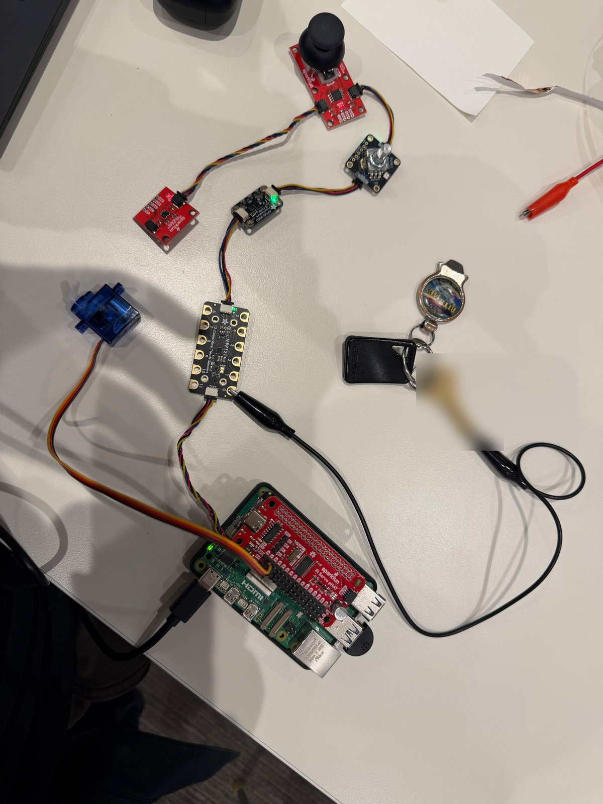
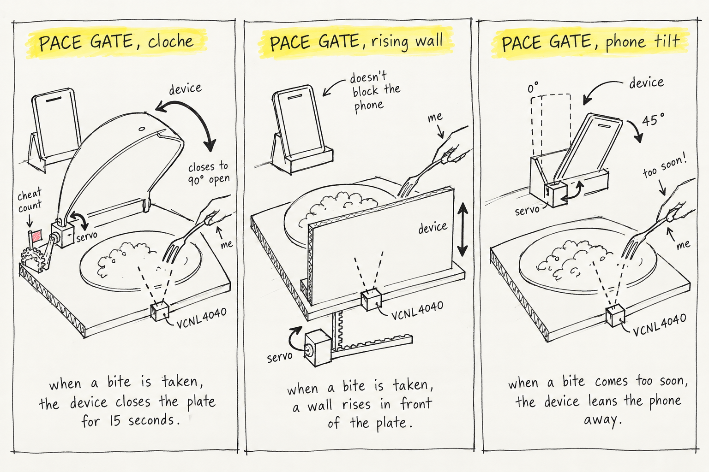
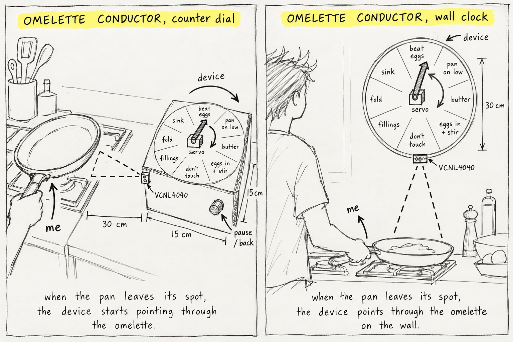
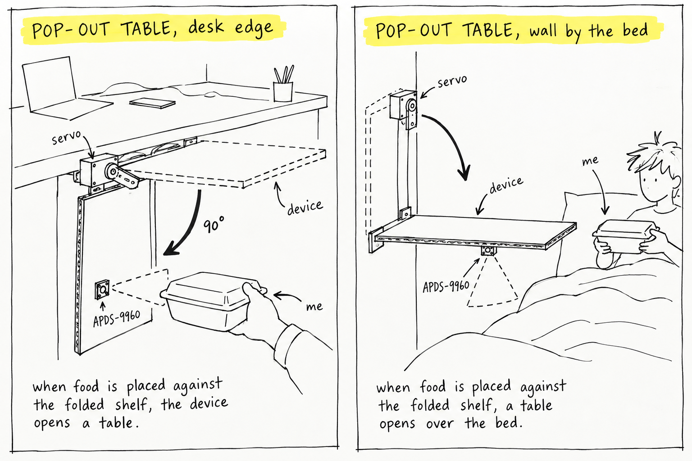
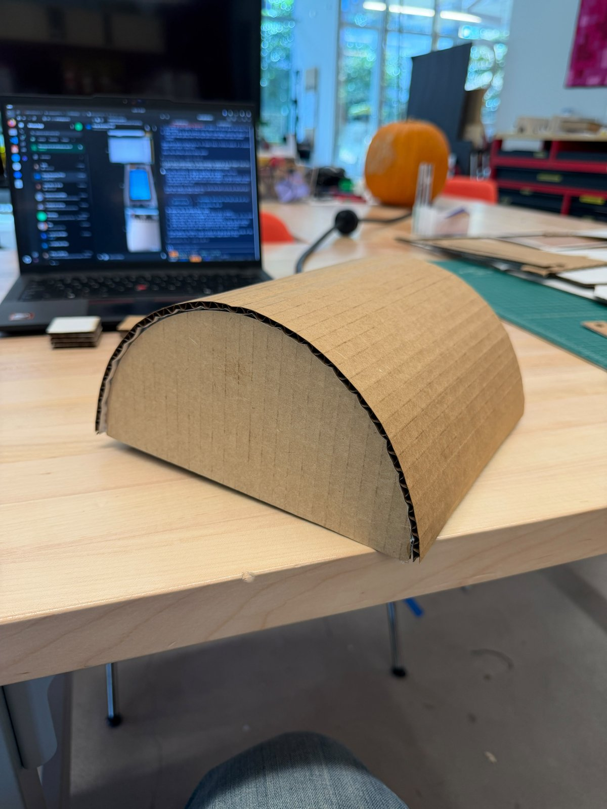
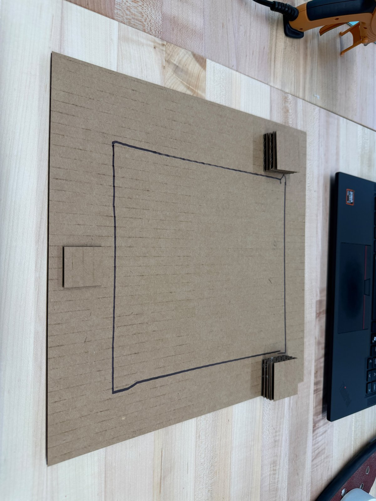
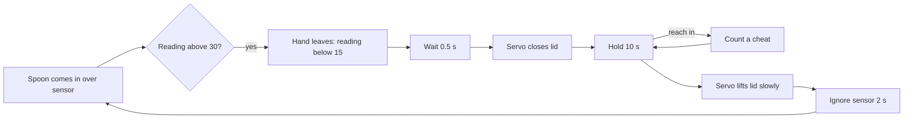
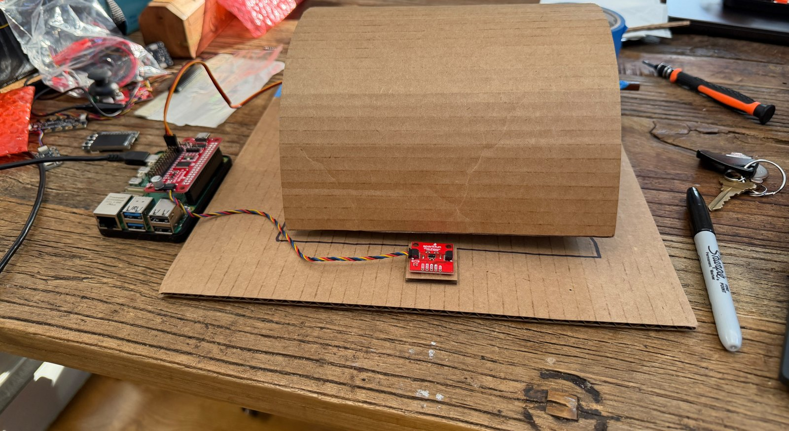
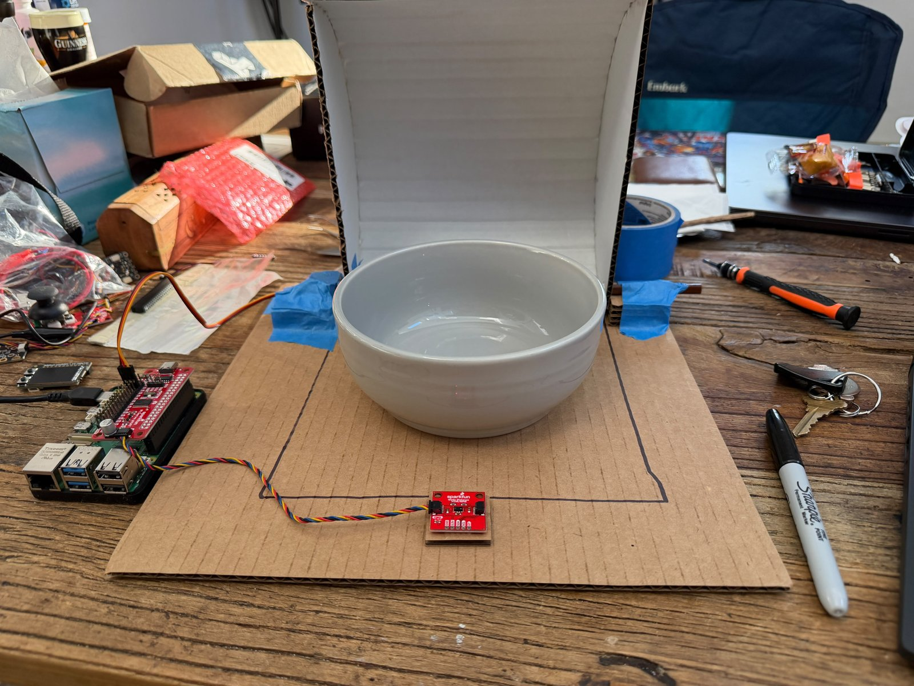

# Ph-UI!!!

**Collaborators:** none, I did this lab alone.

Pace Gate: a cloche that drops over my bowl after every bite so I stop inhaling my food. A distance sensor in front of the bowl sees the spoon come in and go back out, the lid closes for a chewing pause, and reaching in while it is shut counts as a cheat.

---

# Part 1

## A. Capacitive sensing

MPR121 on Qwiic with my keys on pad 11 and a bare alligator clip on pad 0. `cap_test.py` registered touches on both pads, with no false touches. A held touch repeats every 0.25 s, which is the script's poll interval.



## B. More sensors

- **APDS-9960 proximity:** idle 0 to 1, climbing gradually as my hand came closer and saturating at 255 when it was right on top. Good for "something is right here", not for distance.
- **APDS-9960 gesture:** the printed directions matched my swipes, but some swipes were missed.
- **APDS-9960 color:** my room light is warm, so everything read reddish. The blue servo was the only object that clearly shifted the ratio, and color temperature was the most useful single number.
- **Rotary encoder:** worked, but direction is inverted on my unit (clockwise counts down). I lit its NeoPixel red, green and blue.
- **Joystick:** rests around 530 on both axes, 0 to 1023 at the extremes, button reads 0 when pressed.
- **VCNL4040 distance:** about 25 at 20 cm, about 100 at 10 cm, about 500 at 5 cm, about 21,000 touching. Very non-linear, but unlike the APDS-9960 it still tells 20 cm from far away, which is why I used it for Pace Gate.

## C. Servo

The Servo pHAT has its own USB-C power, with the micro servo on channel 0. `pi_servo_hat_test.py` swept 0 to 120 and back smoothly and settled at the 60 degree center every time.

---

## D. Feast Automata

### The dining moment

I eat almost everything alone at my desk, usually takeout, and almost always while watching something on my phone. My real problem is that I eat too fast when I am watching something: big bites, no pause, not enough chewing. I notice it sometimes while it is happening and definitely afterwards. I wanted something that slows me down, gentle or annoying, but a little comedic.

I worked up three concepts: Pace Gate (comedic, slow my eating), Omelette Conductor (useful, a pointer dial that walks me through an omelette, which I always mess up), and Pop-out Table (spatial, a shelf that opens when I hold food against it, because I end up eating on my bed).

### Sketches

Seven arrangements across the three concepts. The drawings were rendered with AI from my own arrangements.



1. **Pace Gate, cloche.** VCNL4040 at the plate rim pointing up, servo hinges a cloche over the plate. When a bite is taken, the device closes the plate.
2. **Pace Gate, rising wall.** Servo drives a rack that raises a wall in front of the plate, phone stays visible.
3. **Pace Gate, phone tilt.** Servo in the phone stand tilts the phone away when a bite comes too soon.



4. **Omelette Conductor, counter dial.** Box next to the stove, VCNL4040 facing the pan's resting spot, servo pointer over the steps, encoder to pause or go back.
5. **Omelette Conductor, wall clock.** Same dial on the wall above the stove, sensor looking down at the pan.



6. **Pop-out Table, desk edge.** Shelf folded down under the desk edge, APDS-9960 on its face, servo swings it up 90 degrees.
7. **Pop-out Table, wall by the bed.** Shelf folded against the wall, servo at the top, sensor under the shelf.

### Questions the sketches raise

**1. Cloche.** Does the VCNL4040 at the front rim see the spoon and hand come in without also seeing the plate rim or the food? Can the servo lift a cardboard dome from a back-corner hinge? Is 15 seconds a pause or a punishment? Cardboard answers all three.

**2. Rising wall.** How tall does the wall need to be to block the plate without blocking the phone? How big does the pinion have to be for 120 degrees of travel? Is a wall that slides up less funny than a lid that drops? Cardboard answers height and funniness; the rack needs a laser-cut test.

**3. Phone tilt.** Where should the pivot sit so the servo isn't lifting the phone's full weight? At what angle does the video become unwatchable? Does tilting the phone slow me down, or do I just lean forward? Cardboard answers all three.

**4. Counter dial.** Does the VCNL4040 see the pan leave at 10 to 15 cm, and does a metal pan read differently from a hand? Does the pan go back to the same spot? The first steps happen before the pan moves, so what starts the dial? Cardboard answers the sensor range and the cradle.

**5. Wall clock.** Does the VCNL4040 even read the pan from above the stove, through steam? Is a 30 cm dial readable while I look down at the pan? Is mounting above a stove safe for the Pi? Cardboard answers readability.

**6. Desk edge.** Can the servo swing a cardboard leaf up 90 degrees? Does the APDS-9960 see a container held against it and ignore my knees? Once the shelf is up the sensor faces the floor, so how does it know the food is gone? Cardboard answers placement and the floor problem.

**7. Wall by the bed.** What does the sensor see folded versus horizontal? Does gravity open the shelf with the servo only releasing a latch? Is this where I actually eat? Cardboard answers all three.

### The pick

Sketch 1, the Pace Gate cloche. I picked the cloche because I eat too fast. I keep going in for bites and can't control myself. Even when I try to be conscious of it, I catch myself swallowing my food too quickly and just inhaling it. I also wanted the device to have some comedy to it, and a lid that slams shut on my plate after every bite felt like the funniest way to make me slow down.

### Rough prototype

I laser cut the parts from 3 mm cardboard at the MakerLAB: a 30 x 30 cm base, a 32 x 20 cm sheet that bends into the lid, two half-circle ends, block layers and a sensor tab. The lid is a half-cylinder that sits over the bowl.




---

# Part 2

## E. Build and integrate

### How it works

- **Sensing:** a VCNL4040 distance sensor faces up in front of the bowl. A bite is the spoon coming in over it and going back out.
- **Actuation:** once the hand has left, plus half a second so the lid never lands on it, the servo drops the lid. It stays shut for 10 seconds, then lifts slowly.
- **Cheats:** reaching in while the lid is shut is counted as a cheat.
- **Not bites:** for 2 seconds after the lid opens the sensor is ignored, so taking the spoon back isn't a bite. If something sits on the sensor for more than 3 seconds, like food I dropped, it says "Sensor covered" instead of counting a bite.

Hardware: Raspberry Pi 5, SparkFun Servo pHAT on its own USB-C, kit micro servo on channel 0, VCNL4040 on Qwiic. The right side of the lid pivots on a chopstick and the left side is screwed to the servo horn.

Code: [`pace_gate.py`](pace_gate.py)

```
python pace_gate.py            # run Pace Gate
python pace_gate.py --watch    # print sensor readings, for tuning the threshold
python pace_gate.py --jog 100  # move the servo slowly between angles, for mounting the lid
```



### Video

[Pace Gate demo (Wizard of Oz)](media/pace-gate-woz-demo.mp4)

The sensing and the timing in the video are real: the terminal is the Pi running `pace_gate.py`. The lid is moved by my hand. The kit micro servo could not move the lid (see below), so I wizarded the actuation and moved the lid on the program's cues. Two bites, one cheat, and taking the spoon back after the lid opened was correctly not counted.

### Iterations

- **Hinge.** A tape hinge on the right side was too floppy to keep the lid lined up, so I replaced it with a chopstick through the right half-circle as a pin hinge.
- **Horn attachment.** Putty and tape could not hold the horn against the pull of the lid. Screwing the horn through the cardboard into the shaft worked.
- **Opening angle.** My first open angle stood the lid fully upright. Past upright, the lid's weight hangs off the horn and the servo stalled and overheated twice. I narrowed the swing and made the code refuse angles past it.
- **Servo strength.** Even inside the narrow range the kit micro servo hummed and barely moved the lid, and only moved it when I nudged it. Next is an MG996R with its own supply.
- **Sensor height.** Flat on the base, a natural bite only read 15 to 20, while idle went up to about 11 with the lid and bowl nearby, so natural bites didn't register. Raising the sensor about 4 to 5 cm gave idle 3 to 8 and natural bites around 60. I set the threshold to 30.
- **Timing.** 15 seconds closed was too much, so I changed it to 10.
- **False bites.** I was worried that taking the spoon back after the lid opens would count as a bite, so I added a 2 second grace period. Food can also drop right onto the sensor, so a reading that stays high for more than 3 seconds is treated as "sensor covered".

### Questions to consider

**How does your chosen sensor or input shape the physical response?**

The lid couldn't come down over the sensor, because then it would read the lid instead of my spoon. That meant the relationship between the lid, the bowl, the spoon and the sensor had to be mapped out exactly: the sensor sits in front of where the lid lands, and the lid only closes after my hand has left.

**How does the physical arrangement of the sensor and actuator change the interaction?**

Raising the sensor made the interaction much more realistic. Flat on the base it only caught my spoon when I went really low, and with it raised I could take normal bites. I didn't put my phone in this setup; there was already a good amount going on.

**What thresholds, timing, or movement patterns make the interaction feel clear or playful?**

15 seconds was too much and I got annoyed. 10 was ok. The cheat had potential to be funny, but only if the machine somehow responded to it. Right now it just counts it.

**What changes when you adjust the sensor placement or servo motion?**

Moving the sensor up changed the most: natural bites started registering. I didn't change the servo motion much. Mostly I had to align it very meticulously at the start so the lid sat closed in the right place.

### Reflection

Movement needs to be balanced. I had to do the whole chopstick hinge because the lid just would not close properly when only one side was held. Moving something in a controlled way also takes way more power than I expected, and the small servo couldn't do it. The device also left me with a spoon in my hand just hanging out while I waited, and that felt unnatural. I think eating is not something that should be treated this way, and building it made that clearer to me than the idea did on paper.

---

## F. Final documentation

**Looks like.** A cardboard half-cylinder about 20 cm long and 10 cm tall that covers a cereal bowl, on a 30 x 30 cm base, with the sensor on a small raised tab in front where my spoon passes.




**Works like.** The sensing and logic run for real on the Pi: bites, the pause, cheats, the grace period and the covered-sensor check all work. The actuation does not yet: the kit micro servo cannot move the lid, and needs a stronger servo.

**Acts like.** The Wizard of Oz video: I take a bite, the lid comes down, I wait, I try to sneak a bite and get caught, the lid lifts.

---

## AI use

The concepts, the arrangements in the sketches, the pick and its reason, and my test observations are mine. The sketches were rendered with AI from my arrangements. I used Claude to organize my concept notes, write `pace_gate.py`, make the laser-cut files, guide the build step by step, transcribe my demo narration, and draft this write-up from my notes, which I reviewed.
