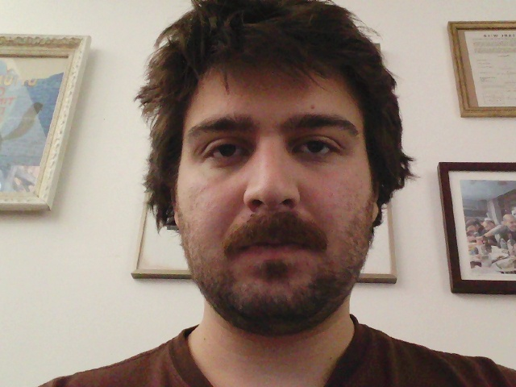
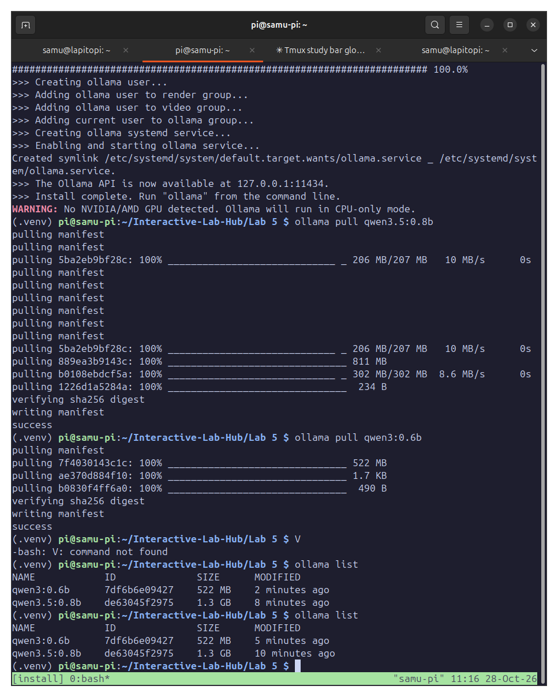
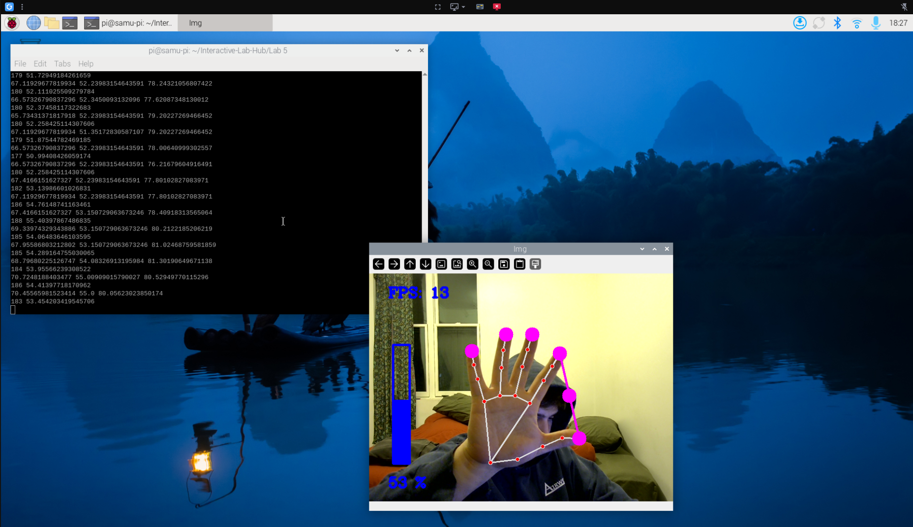
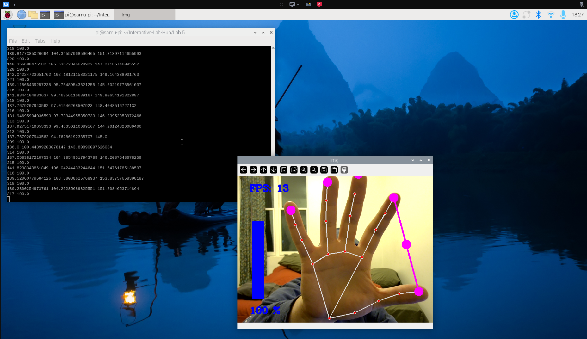
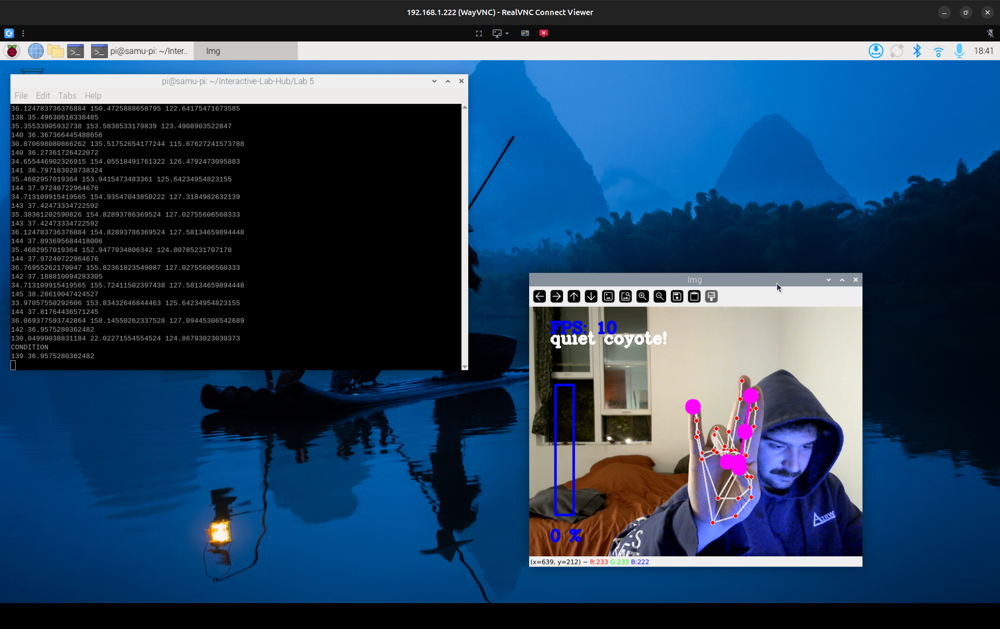
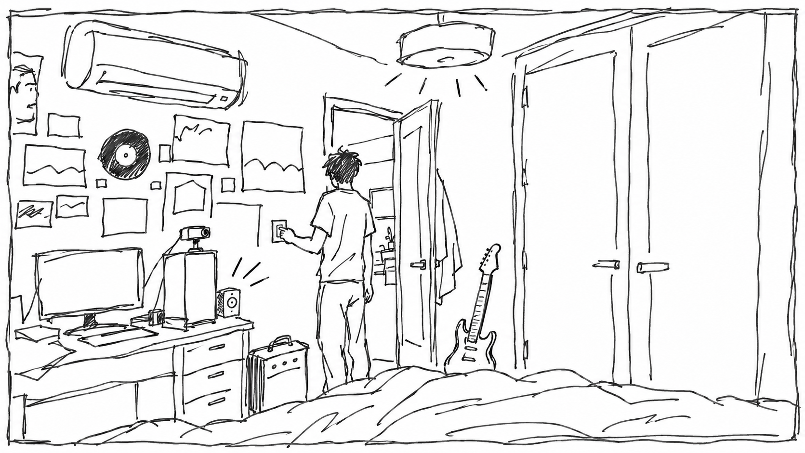
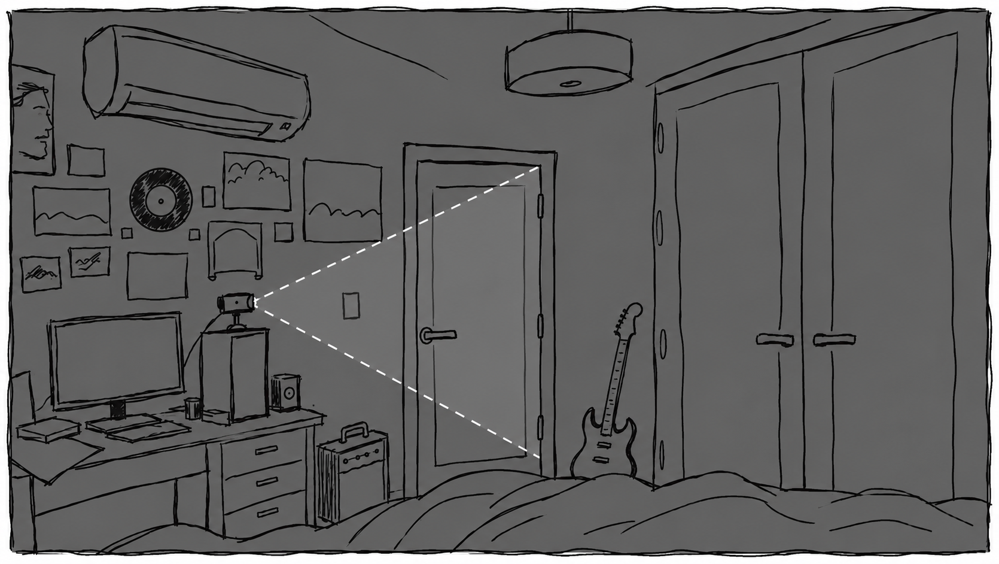
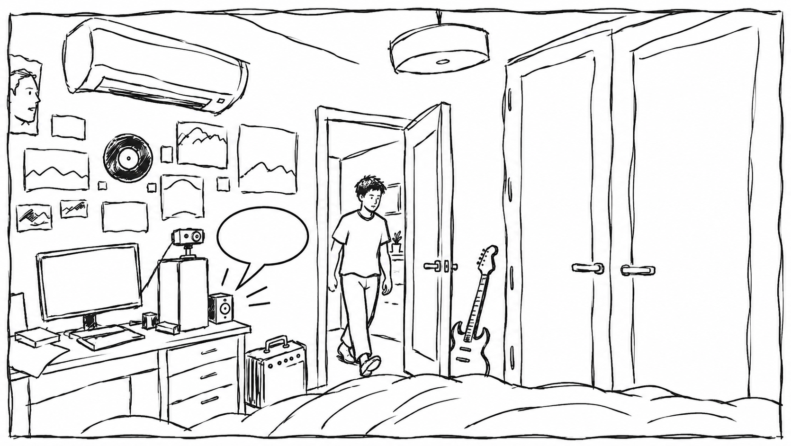
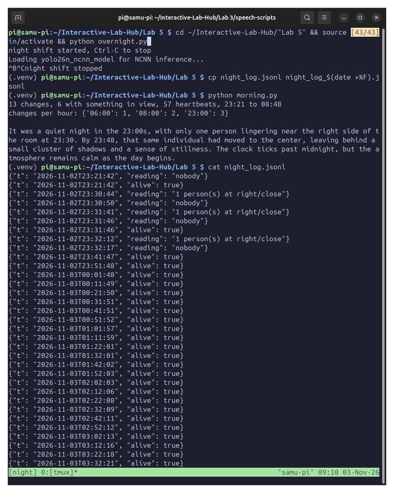

# Observant Systems: Overnight Sensation

**Team:** none, I did this lab alone.

**Members:** Giorgi (Samu) Samushia (gs799, umasshia)

**Project name:** Out the door

**AI use:** Claude helped me organize my notes into these paragraphs and wrote `my_morning.py` from my design. The storyboard panels in Part F were generated with ChatGPT from a photo of my room.

A camera on top of my PC watches my bedroom door all night and tells me in the morning how long after my 7:30 alarm I actually left the room.

---

# Part 1

## A. Set up on-device AI

Venv in `Lab 5`, requirements installed with `uv pip install` (pip's torch download kept stalling on campus wifi, so I ran the uv install inside tmux). `import torch, ultralytics, mediapipe, ncnn, cv2` came back clean. The first ultralytics import spammed the `UnicodeEncodeError` latin-1 traceback, so I added the LANG, LC_ALL and PYTHONIOENCODING lines to `.bashrc` as the handout says.

YOLO26n exported to NCNN in 22.8 s (9.4 MB). `yolo predict` on `bus.jpg` found 4 persons and 1 bus in 77 ms. On this ultralytics version `project=runs` resolves relative to the repo top, so the output landed in `~/Interactive-Lab-Hub/runs/detect/runs/predict` instead of `Lab 5/runs/predict`; the command itself was unchanged. My own `snap.py --delay 3` photo came back as 1 person in 83 ms.



Ollama installed (CPU only on the Pi), `qwen3.5:0.8b` (1.3 GB) and `qwen3:0.6b` (522 MB) pulled.



## B. Recognize people in real time with YOLO

`yolo_person.py` over VNC, with my own HQ webcam because it has a longer cord, repositioned so my whole body fits.

[Video: person detection, default settings (56 s)](media/part-b-yolo-person.mp4)

What I tried on the default run: walking in and out, the confidence went up and down. Sitting down put more of me in the frame and the confidence went up. Turning my back, it went down. Lights off, the camera can't see anything. A photo of a person on my phone was seen as a person with high confidence.

`--conf 0.2`: not much different overall, but it noticed me through the window reflection after I left the frame. `--conf 0.7`: nothing disappeared, the default run was already mostly at 0.83 to 0.91 with one reading at 0.48. `--all`: correct on bed, me, laptop, keyboard and mouse; wrong on my monitor (labeled laptop) and on the elephant on a Jungle Book vinyl on my wall (labeled person). `--headless`: no window, just the printed readings, `person at x=..., height=... px, conf=...` or `0 object(s)`.

[Video: `--all` run with the wrong labels (39 s)](media/part-b-yolo-all.mp4)

Three situations where it did not see me, or saw a person who was not there:

1. Lights off: it did not see me at all. The camera has nothing to work with in the dark, so there is no person to find.
2. `--conf 0.2`, after I walked out of the frame: it kept reporting a person, which was my reflection in the window. A reflection is a real image of a person, and with the threshold that low it counted.
3. `--all`: the elephant printed on the Jungle Book vinyl on my wall was labeled person. A figure-shaped print at a distance looks enough like a person for the nano model.

## C. Hands and pose with MediaPipe

`hand_pose.py` over VNC, 21 landmarks, about 13 FPS. The pinch control worked right away: thumb to index distance sets the volume.




Quiet Coyote fired (`quiet coyote!`, volume 0) only after I fixed my distance to the camera and the finger shape, and it was super inconsistent. The script ANDs five fixed pixel thresholds between fingertips, so the gesture only counts at one distance from the camera, and most frames just missed one of the five.



How I would use hand or body pose in an observant system: a tool that recognizes what chord shape I'm playing on a guitar from my fretting hand and plays along. Either it harmonizes with what I'm playing, or it gives me a background chord and I improvise a little over it. When I change the chord, it recognizes that and follows, and so on.

## D. Qwen on the Pi

`ollama run qwen3.5:0.8b` with `/set nothink`, the Roosevelt Island question in three sentences: 0 of 5 claims true (it invented a 1743 British designation, said the island was discovered uninhabited, had the federal government take it over in the 1860s, named it after Theodore instead of Franklin, and called it a tourist attraction). `ask_qwen.py` with the same question took 14.4 s and was wrong again (built during the Revolutionary War for British forces in the French and Indian War). On `qwen3:0.6b` it took 13.7 s, put the island in the Pacific off California, and wrote five sentences despite the three-sentence system prompt. `ask_qwen.py --image snap.jpg "What is in this photo?"` took 33.7 s and described a man with dark tousled hair and a beard looking at the camera in a brown t-shirt, several framed pictures on a white wall. That one is true.

My three questions, all on `qwen3.5:0.8b`:

1. "Tell me about the country of Georgia." 9.0 s. It said landlocked, in the Caucasus, Russia to the north and west, Armenia east, Azerbaijan south, Turkey southwest, known for history, culture, gold and diamonds. Of 8 claims, 3 are true (Caucasus, Turkey to the southwest, history and culture), 1 partly false (Russia is north, the west is the Black Sea), 1 mostly false (some gold, no diamonds; manganese, copper and Borjomi water are the real ones) and 3 false (landlocked, Armenia east, Azerbaijan south). The general picture is right and the specifics are wrong.
2. "When did Georgia join the European Union?" 3.0 s. "Georgia joined the EU on January 1, 2009." It accepted a false premise and invented a date. Georgia never joined: it applied in March 2022 and got candidate status in December 2023, and nothing since. No country joined in 2009 either (Bulgaria and Romania 2007, Croatia 2013).
3. A narrow job with the facts supplied: five facts (South Caucasus with a Black Sea coast, the borders, applied March 2022, candidate December 2023, not in the EU), the rule "only use the facts, otherwise say it is not in the facts", and three questions: landlocked? when did it join the EU? capital? 11.3 s. Answers: "No, it has a coastline on the Black Sea" (correct from the facts); "Georgia joined the EU in March 2022" (wrong, it turned applied into joined, ignored the not-in-the-EU fact and followed the question's premise); "The capital of Georgia is Tbilisi" (true, but not in the facts, so wrong by the rule).

Question 3 again on `qwen3:0.6b`: 4.6 s instead of 11.3 s. "No, Georgia is not landlocked" (right), "Georgia joined the EU in December 2023" (wrong), "Georgia's capital is Bucharest" (wrong, that is Romania).

What I took from this into Part E: facts in the prompt help, but the model bends them toward the question and ignores a rule like only-the-facts, and it has no memory between runs. Time depends on the prompt and the answer length more than on the question. Keep the questions simple and check every answer against the log.

## E. From YOLO readings to Qwen reasoning

`yolo_to_qwen.py` for one minute, twice, through VNC. The first run I came in from the right close, went to center far (my room is not big enough), then went close to the camera, and it stopped before I could walk off. The log:

```
17:46:17 nobody
17:46:37 1 person(s) at right/close
17:46:38 1 person(s) at center/close
17:46:40 1 person(s) at right/close
17:46:54 1 person(s) at center/close
```

Second run, with what I was actually doing next to each line:

```
17:52:37 nobody
17:52:45 1 person(s) at right/close     true
17:52:46 1 person(s) at center/close    true
17:52:47 1 person(s) at right/close     true
17:52:57 1 person(s) at center/close    I was trying to be as far as I can, but I have a small room
17:53:07 1 person(s) at left/close      similar distance as before, but yes, to the left
17:53:18 nobody                         walked out of frame
17:53:25 1 person(s) at left/close      walked across the frame, these four are right
17:53:26 1 person(s) at center/close
17:53:27 1 person(s) at right/close
17:53:27 nobody
17:53:33 1 person(s) at right/close     walked back in at right, it's right
```

Qwen (15.5 s) on that log: "There was only one person present throughout the entire 61-second observation period. They were consistently located either at the right or center of the room, never moving to a different position. No changes occurred in their location or activity during this time."

Sentence by sentence: the first one I read as no more than one person, which is true, although the log has three `nobody` lines. The second missed left completely. The third is wrong too: the log only writes a line when the reading changes, and it wrote 14.

One thing the log never says is `far`. My room is small, so my box was always taller than 60 % of the frame. The interpreter can tell left, center and right in my room, but not distance.

## F. Storyboard

Things I wanted to know when I wake up: how late I went to sleep, how restless I was, whether I got up during the night, and how long it actually took me to get out of bed after my alarm. I went with the last one.

My alarm is always at 7:30. The webcam sits on top of my PC box facing my bedroom door, with the bed out of the frame. If I walk past that frame, I'm definitely up.



Before bed, I turn the lights off, and that's the hand-off. The Pi notices the frame going dark (a simple average-brightness check, since YOLO can't see lights off on its own) and plays a short beep through a speaker, so I know it's watching for me after 7:30.



While I sleep, the camera watches the closed door, one look every few seconds, and logs nobody or a person.



When I'm up, the Pi has Qwen turn the log into one sentence and reads it out loud through the same speaker with text-to-speech, something like "You got up 22 minutes after your alarm." Qwen takes about 20 seconds, so whether I'm still close enough to hear it is something to test. Detecting the alarm sound with the webcam's mic would be a later improvement, not built here.

Panels generated with ChatGPT from a photo of my room.

---

# Part 2

## Prep for Part 2

Feedback on the storyboard from a housemate, after looking at the three panels:

1. "Isn't this really timing when you leave your room, not when you get out of bed? You could be up and getting dressed for twenty minutes before you walk out."
2. "What if you just go to the bathroom and then get back in bed? It'd think you were up."
3. "By the time it tells you, aren't you already out the door? Who's it talking to?"
4. "What happens on days your alarm isn't at 7:30, like weekends? It'll just be wrong."
5. "If you turn the light off to go out at night, won't it think you're going to bed?"
6. "It's a neat idea, but couldn't a clock do most of this? What's the smart part actually doing?"

The Pi spends the night in my room, on top of the PC box, facing the door, bed out of frame. My housemates are fine with it; the door is closed overnight, so nobody but me is ever in the frame.

### Revised storyboard

What I changed after the feedback and after Part E:

1. Leaving my room vs getting out of bed: keep, but reword. The camera can only tell me when I'm at the door, and in my room everything reads close anyway, so it can't tell getting out of bed from standing at my desk. The question is now how long after my alarm did I leave my room, which is what it actually measures and still what I want to know.
2. A bathroom trip isn't getting up: change. Since the log only writes when something changes, a bathroom trip shows up as me leaving and coming back a few minutes later. My rule: I count as up at the first time I leave after 7:30 and don't come back within 10 minutes. A long shower followed by coming back to get dressed could still fool it.
3. The answer comes after I've left: change. Because of the 10-minute rule the Pi can't know I'm really up the moment I walk out anyway. So the answer waits until the next time the camera sees me come back into my room, and the speaker tells me then: "This morning you left your room at 7:52, 22 minutes after your alarm." Panel 3 above is the redrawn version, me walking back in.
4. Fixed 7:30: keep. My alarm is the same on weekdays, so it only runs on those days, and a different alarm time would give a wrong answer.
5. Lights off by accident: change. The hand-off only counts after 10 pm, so turning the light off to go out earlier in the evening doesn't trigger the beep.
6. What the smart part is doing: change. Code finds the times, applies the 10-minute rule and works out the minutes. In Part E Qwen missed things in a short log and said nothing changed when a lot did, so it gets a narrow job: it gets the computed facts (alarm time, when I left, any short trips before that) and turns them into one sentence for me.

## G. The interaction before

After 10 pm, I turn the lights off. That's the whole hand-off, nothing to press or say. The Pi notices the frame going dark with an average-brightness check and answers with a short beep through the speaker, which tells me it has taken the night. Under 30 seconds, and it is something I do anyway.

For the first real night the beep was not built yet, so I acted the hand-off out on video with the night shift already running:

[Video: the hand-off, lights off at 11:40 pm (41 s)](media/part-g-handoff.webm)

The night log caught me at right/close three times between 23:30 and 23:32 while I was setting up and filming the first take, five seconds each time. It did not catch the second take at all, even though I stood at the switch for 20 seconds with the lights on. The switch is on the same wall as the camera, almost beside it, so it is either outside the camera's cone or too close to make a person box. The camera watches the door well and the hand-off spot badly, which is one more reason the hand-off trigger is the brightness drop and not a person box.

## H. The overnight run

Fake night first: `overnight.py` for a few minutes while I walked in and out of the door frame, then `morning.py`:

```
6 changes, 3 with something in view, 2 heartbeats, 23:07 to 23:14
changes per hour: {'23:00': 3}

The camera captured a quiet night shift, with only one person visible throughout the entire period. The sequence of entries suggests a routine activity centered on the center of the room, though the specific location remained consistent across different times of day. There is no indication of any unusual events or significant changes in the environment during this brief window.
```

The snapshot it saved confirmed the framing: door and hallway in the frame, poster wall on the left, the guitar's headstock bottom right, no bed. I renamed that log to `fake_night.jsonl` so the real night starts clean, since `overnight.py` appends.

Real night: started 23:21:42 on November 2 in a tmux session, plain `overnight.py`, one look every 5 seconds, people only, and stopped at about 8:50 the next morning. The [night log](night_log.jsonl) has 13 changes, 6 with someone in view, and 57 heartbeats, so the Pi stayed up all night. Without the heartbeats, the night is:

```
23:30:44  right/close    setting up and filming the hand-off
23:31:41  right/close
23:32:12  right/close
06:37:26  center/close   I got up for a sec to get my phone, which was in camera view
08:35:12  center/far     I left the room
08:48:18  center/close   I came back in
```

08:35 is the only `far` reading in the whole lab. At the door I'm finally far enough from the camera for my box to be under 60 % of the frame.

The handout's `morning.py` on that log:



"It was a quiet night in the 23:00s, with only one person lingering near the right side of the room at 23:30. By 23:48, that same individual had moved to the center, leaving behind a small cluster of shadows and a sense of stillness. The clock ticks past midnight, but the atmosphere remains calm as the day begins."

It never mentions 6:37 or the morning, and 23:48 and the center are made up: the log has me at right/close from 23:30 to 23:32 and nothing at 23:48.

## I. The interaction after

[my_morning.py](my_morning.py) is my version. The answer is worked out in code. It finds the first time the camera sees me at the door after 7:30 that isn't followed by another sighting within 10 minutes (a sighting followed by one within 10 minutes is a short trip), and the next sighting after that is me coming back. Qwen only gets those facts and turns them into one sentence, and Piper from Lab 3 reads it through the speaker. If Qwen's sentence is missing the time or the minutes, the script uses a plain sentence instead. If the camera never saw me leave after the alarm, it says so in a fixed sentence and doesn't ask Qwen at all.

On the real night:

```
Alarm: 7:30
Got up and left the room: 8:35, 65 minutes after the alarm
Came back into the room: 8:48
Short trips out and back after the alarm, before that: none
Seen at the door before the alarm: 6:37
[qwen3.5:0.8b, 9.6 s] You left your room at 8:35, which is 65 minutes after the alarm went off at 7:30.
```

The speaker said it out loud.

[Video: the morning answer (31 s)](media/part-i-morning.mp4)

For the video I started it by hand after walking back in, since the night shift was already stopped. `--watch` is the mode that runs next to `overnight.py` and answers on its own when I walk back in; it is written but I haven't run it live yet.

## Final documentation

[Video: the whole system, the hand-off at night and the answer in the morning (72 s)](media/whole-system.mp4)

Looks like: the webcam sits on top of my PC box on the desk, facing my bedroom door, with the bed out of the frame, and the Lab 3 speaker sits on the desk next to the Pi. At night it's a dark room with a closed door. In the morning it's the same view with me walking back in and the speaker talking.

Works like: `overnight.py` runs YOLO26n on NCNN once every 5 seconds, turns each frame into a reading with `interpret()` from Part E, and writes it to [night_log.jsonl](night_log.jsonl) only when it changes. In the morning `my_morning.py` reads the log, applies the 10-minute rule and gives Qwen (qwen3.5:0.8b through Ollama) just the computed facts, and Piper speaks the sentence. Everything runs on the Pi, offline.

Acts like: before bed I turn the lights off, and that's the hand-off. In the morning I leave and come back, and it tells me when I left and how many minutes after my alarm that was. Last night it was 8:35, 65 minutes.

Not built yet: the brightness check and beep for the hand-off (acted out in the video instead) and the 10 pm cutoff that goes with it.

Code: [my_morning.py](my_morning.py), plus the handout's `overnight.py`, `yolo_to_qwen.py` and `morning.py` in this folder.
